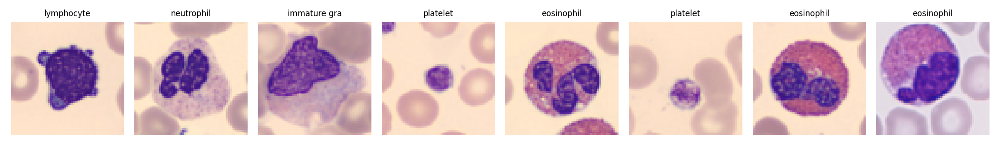
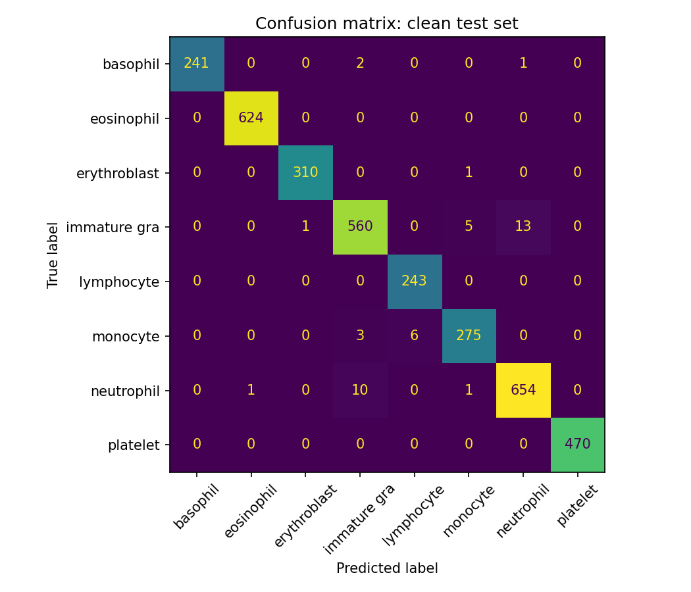
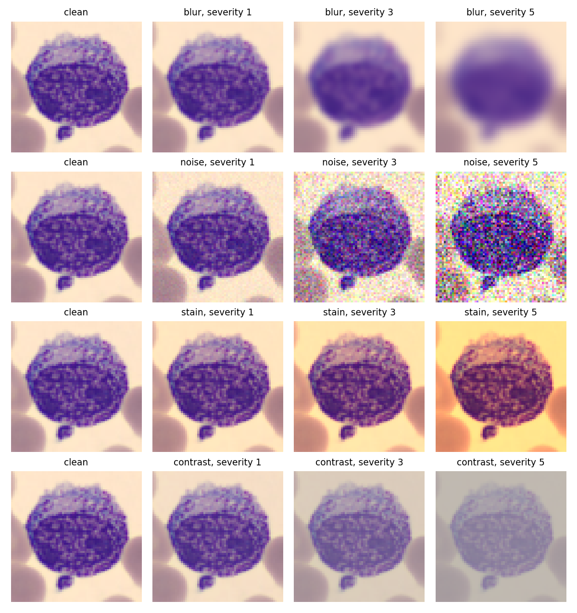
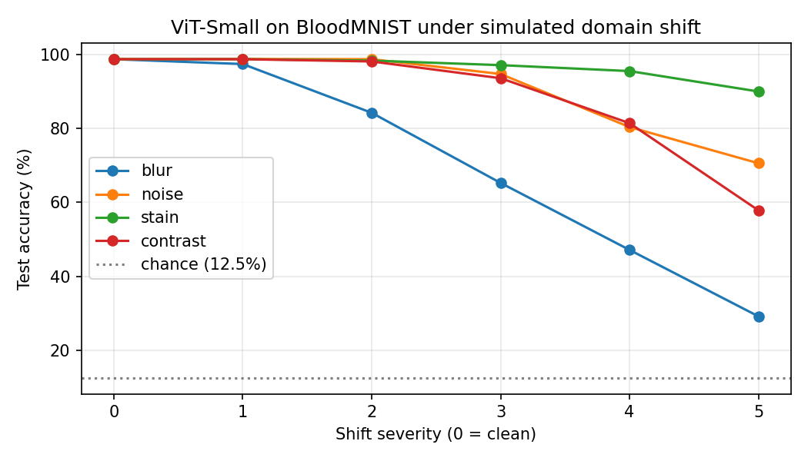
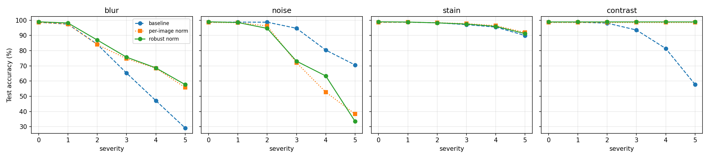

# Domain Shift and Per-Image Normalization in a Vision Transformer for Blood Cell Classification

**Normalizing each image by its own statistics made a ViT exactly invariant to contrast shift (57.8% → 99.0% accuracy at the most severe level) and much more robust to blur (29.1% → 57.7%), but more fragile to noise (70.6% → 33.4%). Every invariance has a price.**

## Motivation

A model trained on images from one lab is often deployed on images from another, acquired with different microscopes, cameras, and staining protocols. These **domain shifts** can silently degrade accuracy. This project asks:

1. How does a strong Vision Transformer degrade under controlled, acquisition-like shifts in blood cell microscopy?
2. Can a simple structural prior, normalizing each image by its own statistics, make the model invariant to some of these shifts, and at what cost?

The normalization idea is adapted from my earlier work on condition-aware time-series models, where normalizing each operating regime with its own statistics removed regime-specific variation before temporal modeling.

## Setup

| Item | Details |
|---|---|
| Data | [BloodMNIST](https://medmnist.com/): 17,092 microscope images of normal blood cells, 8 classes; standard splits of 11,959 train / 1,712 validation / 3,421 test; used at 64×64 and upsampled to 224×224 |
| Model | ViT-Small/16 (`vit_small_patch16_224.augreg_in21k_ft_in1k` from `timm`), 21.7M parameters, pre-trained on ImageNet-21k; new 8-class head; dropout 0.1 before the head and in the attention/MLP projections |
| Training | 5 epochs, AdamW (lr 1e-4, cosine decay, weight decay 0.05), batch size 64, mixed precision, random horizontal/vertical flips; ~40 s per epoch on a Colab T4 |
| Model selection | Best epoch by validation accuracy; the test set is used only for final evaluation |
| Metrics | Accuracy, balanced accuracy (mean per-class accuracy), and top-prediction share (fraction of images assigned to the most frequently predicted class) |

## Clean baseline

| | Validation | Test |
|---|---|---|
| Accuracy | 99.01% | 98.71% |
| Balanced accuracy | 99.17% | 98.77% |

Per-class test accuracy ranges from 96.72% (immature granulocytes) and 96.83% (monocytes) to 100% (eosinophils, lymphocytes, platelets). The weakest classes are morphologically close to neutrophils and to each other.

## Simulated domain shifts

Each shift is applied to the raw [0, 1] images at 64×64, before resizing and normalization, at five severity levels. The model is not retrained.

| Shift | Simulates | Severity 1 → 5 |
|---|---|---|
| Blur | Defocused microscope | Gaussian σ = 0.5, 1.0, 1.5, 2.0, 3.0 px |
| Noise | Noisier sensor / low light | Gaussian noise std = 0.02, 0.05, 0.10, 0.15, 0.20 |
| Stain | Different staining protocol | Red channel ×(1 + a), blue ×(1 − a), a = 0.05 … 0.30 |
| Contrast | Different illumination / camera settings | Contrast retained = 90%, 75%, 60%, 45%, 30% |

### Baseline robustness

- **Blur is the most damaging shift.** A one-pixel blur (severity 2) already costs 14 points, and severity 5 drops accuracy to 29.1%. The model appears to rely heavily on fine texture such as cytoplasmic granules.
- **Contrast** is harmless at low severity but collapses at high severity (57.8%).
- **Noise** degrades accuracy to 70.6% at severity 5, and hits rare classes harder (balanced accuracy 61.5%).
- **Stain** is the mildest shift (90.0% at severity 5).
- **Prediction collapse:** at blur 5 and contrast 5, 46.8% and 50.5% of all test images are assigned to a single class, compared with 19.5% on clean data. The model does not degrade into random guessing; it confidently labels most cells as one type.

## Per-image normalization

Instead of fixed dataset-wide statistics, each image is normalized by its **own per-channel mean and standard deviation**.

**Hypothesis:** this makes the model invariant to stain shift (each channel multiplied by a constant) and contrast shift (pixels pulled toward the mean), because standardization cancels both. It should not help with blur or noise, which change image structure.

Two variants were trained with identical settings (same pretrained weights, seed, data order, and schedule):
- **Per-image norm:** statistics from the image itself.
- **Robust norm:** statistics from a Gaussian-blurred copy (σ = 1.5) applied to the original image, intended to keep the statistics stable under noise.

### Results at the most severe level (severity 5)

| Shift | Baseline | Per-image norm | Robust norm |
|---|---|---|---|
| Clean (no shift) | 98.71% | 98.54% | 98.98% |
| Blur | 29.14% | 55.80% | **57.67%** |
| Noise | **70.56%** | 38.29% | 33.44% |
| Stain | 89.97% | **91.96%** | 91.20% |
| Contrast | 57.82% | 98.54% | **98.98%** |

Full results (test accuracy, all severities)

| Shift | Severity | Baseline | Per-image norm | Robust norm |
|---|---|---|---|---|
| Clean | 0 | 98.71 | 98.54 | 98.98 |
| Blur | 1 | 97.40 | 97.46 | 98.22 |
| Blur | 2 | 84.22 | 83.98 | 86.99 |
| Blur | 3 | 65.24 | 74.74 | 75.71 |
| Blur | 4 | 47.12 | 68.40 | 68.66 |
| Blur | 5 | 29.14 | 55.80 | 57.67 |
| Noise | 1 | 98.77 | 98.39 | 98.51 |
| Noise | 2 | 98.71 | 96.26 | 94.65 |
| Noise | 3 | 94.71 | 72.03 | 73.08 |
| Noise | 4 | 80.36 | 52.70 | 63.34 |
| Noise | 5 | 70.56 | 38.29 | 33.44 |
| Stain | 1 | 98.71 | 98.71 | 98.83 |
| Stain | 2 | 98.33 | 98.36 | 98.28 |
| Stain | 3 | 97.11 | 97.78 | 97.49 |
| Stain | 4 | 95.50 | 96.43 | 95.97 |
| Stain | 5 | 89.97 | 91.96 | 91.20 |
| Contrast | 1 | 98.71 | 98.54 | 98.98 |
| Contrast | 2 | 98.10 | 98.54 | 98.98 |
| Contrast | 3 | 93.57 | 98.54 | 98.98 |
| Contrast | 4 | 81.41 | 98.54 | 98.98 |
| Contrast | 5 | 57.82 | 98.54 | 98.98 |

Raw results: `results/shift_results.csv`, `results/shift_results_perimage.csv`, `results/shift_results_robust.csv`.

### What the results show

- **Contrast: exact invariance, as predicted.** Both normalized models score exactly their clean accuracy at every contrast severity.
- **Stain: improved, but not fully invariant.** At high severity, bright background pixels in the red channel are clipped at 1.0, which breaks the pure per-channel scaling that standardization can undo.
- **Blur: a large, unpredicted gain** (+28.5 points at severity 5). A likely explanation is that blur also reduces image contrast, and normalization restores that component, leaving only the genuinely lost detail.
- **Noise: a large loss, and the robust variant did not fix it.** My initial explanation was that noise inflates the standard deviation used for normalization. If that were the main cause, the robust variant, whose statistics are largely insensitive to noise, should have recovered accuracy. It did not, so that explanation is falsified.

**Revised hypothesis:** the baseline can rely on global intensity and color cues, which are robust to zero-mean noise because averaging over many pixels cancels it. Per-image normalization removes these cues by design, forcing the model to rely on fine structure, which noise destroys. The invariance that protects against contrast and stain shift also removes information that would otherwise survive noise.

## Limitations

- **Synthetic shifts:** blur, noise, stain, and contrast are controlled approximations of inter-lab variation, not real multi-center data.
- **Single run per model:** differences below about 1 point (e.g., clean accuracy across models) are within run-to-run variation, and results at high noise severity fluctuate between models. Multiple seeds would be needed for firm conclusions.
- **One dataset, low resolution:** BloodMNIST at 64×64 only.
- **The revised noise hypothesis is untested.**
- **The robust variant's blur width (σ = 1.5) was chosen a priori, not tuned.**

## Future work

- Repeat all experiments over multiple seeds and report confidence intervals.
- Test the revised hypothesis directly, for example by feeding the removed per-image statistics back to the normalized model as an extra conditioning token, so it gains invariance without losing the global cues.
- Combine normalization with noise and blur augmentation during training.
- Evaluate on real multi-site data, e.g., blood smear or histopathology datasets collected at different hospitals.
- Use predictive uncertainty (Monte Carlo Dropout is already enabled in all models) to detect when the model is operating under shift, before its predictions collapse.

## Repository contents

- The Colab notebook with all steps, in order, with explanations.
- `results/`: figures, per-setting CSVs, and `clean_test.json` with the clean test metrics.

## Reproducing

Open the notebook in Google Colab with a T4 GPU runtime, mount Google Drive, and run all cells in order. Checkpoints and results are saved to Drive, and training resumes automatically from the last checkpoint after a disconnection. All randomness is seeded. Total runtime is about 25 minutes.

## Author

Mubashar Abbas, MS Data Science (NUST, 2026). Research interests: reliable and structure-aware deep learning, domain generalization, uncertainty-aware machine learning.